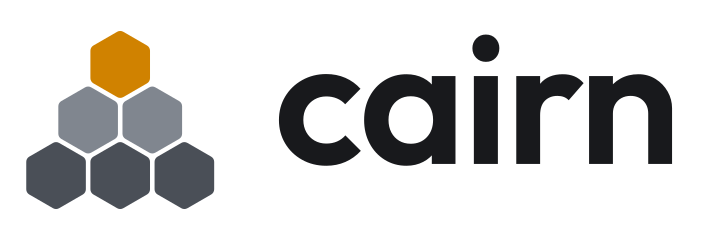

A desktop Linux distribution built on Fedora Kinoite (Fedora Atomic + KDE Plasma),
with its own clean, hexagon-based look and updates that can't break your system.

**Status:** v0.1 in progress. Testing in virtual machines; not ready for real computers yet.

## Try it

Step-by-step guides: [VirtualBox](docs/install-virtualbox.md) · [VMware Workstation](docs/install-vmware.md).

## What's inside

- KDE Plasma in Cairn's graphite-and-honey look, dark by default
- Firefox, VS Code, Git, Distrobox, Steam, and the everyday KDE apps
- Full media codecs
- Automatic updates in the background that apply at restart, with the previous version always one click away

## How it works

- [The plan](docs/PLAN.md): what Cairn is, every decision behind it, and the roadmap
- [How Cairn is built](docs/how-it-works/image.md)
- [Where the apps come from](docs/how-it-works/apps.md)
- [How updates work](docs/how-it-works/updates.md)
- [How GitHub builds it](docs/how-it-works/github-builds.md)
- [Cairn's look](docs/brand.md): logo, colours, wallpaper
