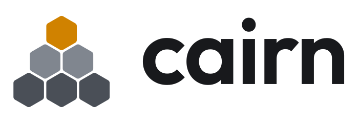

# Cairn's look

Picked in Step 0: **logo D (Honeycomb)**, **Outfit** for the wordmark, and the colours below.



## Logo

Six equal hexagons stacked 3-2-1, like stones on a trail marker: three dark stones,
two lighter ones, and one honey cell on top. The cells are the same shape as the
honeycomb on the wallpaper, so the wallpaper literally contains the logo.

| File | Use it on |
|---|---|
| `brand/logo/cairn-logo.svg` | dark backgrounds (also the system icon, `cairn-logo`) |
| `brand/logo/cairn-logo-light.svg` | light backgrounds |
| `brand/logo/cairn-wordmark.svg` | logo + name, dark backgrounds |
| `brand/logo/cairn-wordmark-light.svg` | logo + name, light backgrounds |

The name is always lowercase in the wordmark (**cairn**) and capitalised in sentences (Cairn).
The wordmark's letters are converted to shapes, so it looks the same everywhere without the font installed.

## Colours

Cool graphite greys with one warm honey accent. Each grey is named after a stone.

### Dark (default)

| Name | Hex | Role |
|---|---|---|
| Graphite | `#121316` | Desktop background |
| Slate | `#1B1D21` | Windows |
| Shale | `#24272C` | Title bars, panel |
| Seam | `#33363D` | Borders |
| Mist | `#ECEDEF` | Text (14.4:1 on Slate) |
| Fog | `#A3A7AF` | Secondary text (7.0:1 on Slate) |
| Honey | `#F4A62A` | Accent (8.3:1 on Slate) |

### Light

| Name | Hex | Role |
|---|---|---|
| Chalk | `#F4F4F5` | Desktop background |
| Quartz | `#FFFFFF` | Windows |
| Limestone | `#E9EAEC` | Title bars, panel |
| Seam | `#D7D9DD` | Borders |
| Ink | `#18191C` | Text (17.6:1 on Quartz) |
| Pewter | `#5C6068` | Secondary text (6.3:1 on Quartz) |
| Deep honey | `#D08200` | Buttons, logo, highlights |
| Honey ink | `#A35F00` | Amber text and links (5.0:1 on Quartz) |

Rules that keep it readable:

- Text on honey is always dark (Ink), never white.
- Light mode uses Deep honey for fills, because the bright Honey almost disappears on white.
- Every text colour passes WCAG AA (4.5:1).

## Type

- **Wordmark and big titles:** Outfit SemiBold (SIL Open Font License).
- **Desktop font:** still open, decided with the v0.2 theme.

## Where it lives in the system

| What | Source in this repo | Installed to |
|---|---|---|
| Logo icon | `brand/logo/cairn-logo.svg` | `/usr/share/icons/hicolor/scalable/apps/cairn-logo.svg` |
| Wallpaper | `brand/wallpaper/Cairn/` | `/usr/share/wallpapers/Cairn/` |
| Colour schemes | `brand/plasma/color-schemes/` | `/usr/share/color-schemes/` |
| Global theme | `brand/plasma/look-and-feel/org.cairn.desktop/` | `/usr/share/plasma/look-and-feel/org.cairn.desktop/` |

## Regenerating the files

The logo, wallpaper and colour schemes are generated by scripts, so a colour change is one edit and one command:

```sh
python3 brand/tools/make_logo.py path/to/Outfit[wght].ttf brand/logo   # needs fonttools + uharfbuzz
node brand/tools/make_wallpaper.js brand/wallpaper/Cairn                  # needs Playwright
python3 brand/tools/make_color_schemes.py brand/plasma/color-schemes
```

Outfit is available from [Google Fonts](https://github.com/google/fonts/tree/main/ofl/outfit).
